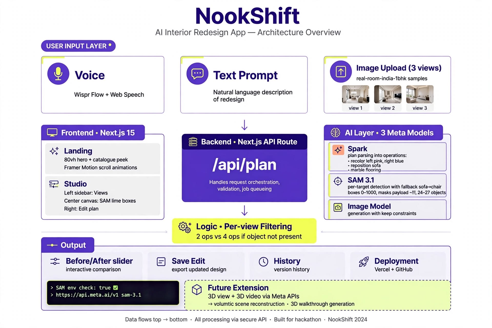
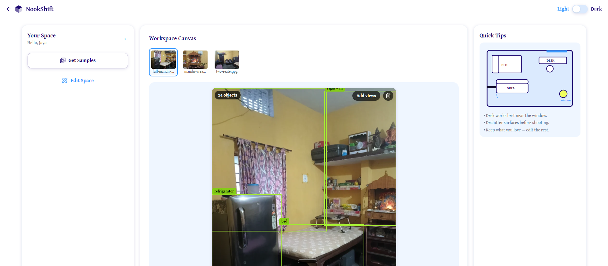
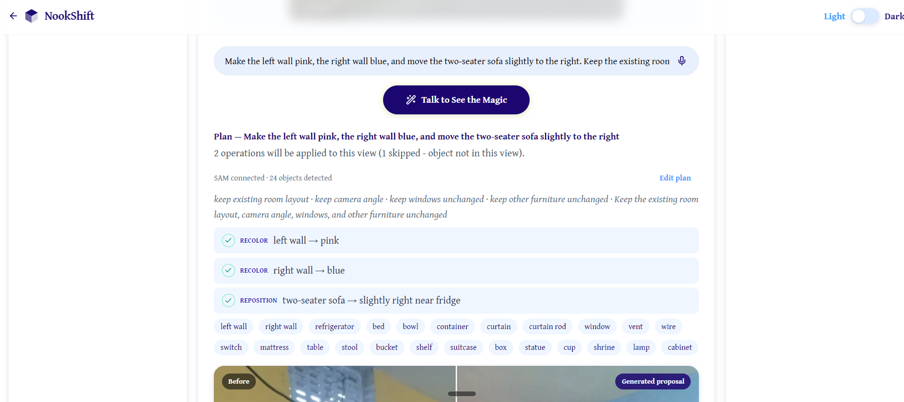
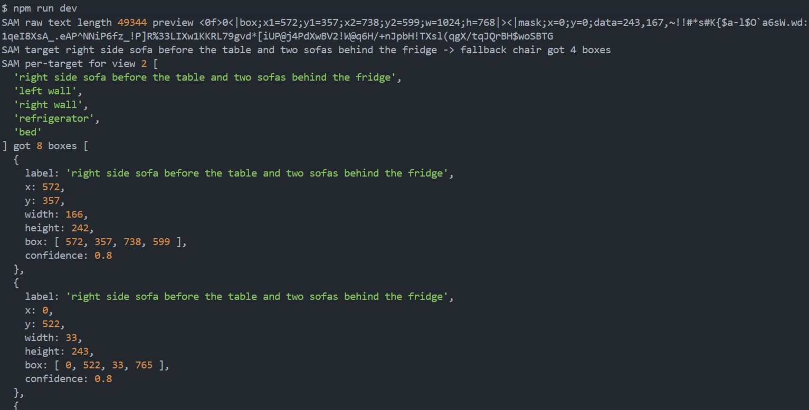
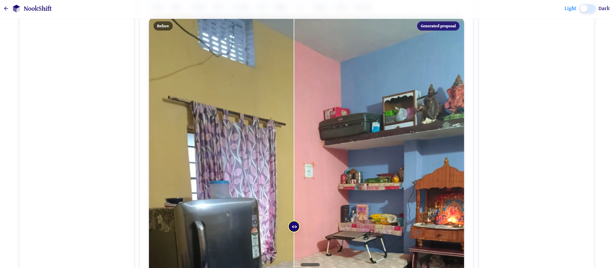

# NookShift

See First, Analyze the Feel, Then Change - redesign your room from photo plus text voice before moving furniture, built with Wispr Flow end to end.

## Quick Links

- Deployed Website: [CLICK HERE](https://nookshift-jd.vercel.app/)
- Demo Video: [WATCH HERE](https://www.youtube.com/watch?v=lM_i0MknNa0&t=3s)



## Architecture Flow

Client UI (Next.js on Vercel) ->
Vercel hosting ->
Next.js API Route `/api/plan` ->
Meta Spark + SAM 3.1 + Image Model ->
Logic: Per-view Filtering ->
Output: Before/After slider

## Quick Start

```bash
npm install
npm run dev
```

Open http://localhost:3000.

## Environment Variables

Create `.env.local` in the project root:

```env
MODEL_API_KEY=your-meta-api-key
SAM_MODEL=sam-3.1
```

## API Highlights

`POST /api/plan` takes a prompt, base64 image(s), and `roomName`. It returns the plan, connected SAM results with boxes and masks, and `proposalUrl`.

- Per-target fallback tries the requested object, then alternatives such as sofa to chair.
- Box coordinates use a 0-1000 scale.
- Non-empty masks are returned as data (for example, `599,479,...`), not empty placeholders.
- SAM reports typically include 24-27 detected objects.

## Screenshots

The terminal proof shows the SAM environment check as `true`, base URL `https://api.meta.ai/v1`, and model `sam-3.1`. The raw response text length was 10756 and included mask data; lime boxes identified the refrigerator, bed, and left wall.









## Compliance Declaration

- Meta Model API is the only inference provider; no competitor cloud is used.
- Processing runs through Next.js API routes on Vercel.
- Wispr Flow was used for development typing, including approximately 80 percent of the typing workflow.

## Short Notes

Wispr Flow was used across Copilot Chat, Meta AI, ChatGPT, and the browser, accounting for about 80 percent of typing.

## Vercel Deployment

```bash
vercel --prod
```

## Future Enhancements

- 3D image view.
- 3D video generation through Meta APIs.

## Features

- Upload a room photo or choose a sample; uploads are compressed client-side to a 1024px WebP.
- `muse-spark-1.3` creates a structured redesign plan.
- `sam-3.1` detects targets, returns boxes and non-empty masks, and uses per-target fallbacks when needed.
- `muse-image-1.0` generates image edits for the before/after slider.
- Edit operations can be changed and resubmitted. Save Edit stores results locally, and Saved Edits appears on the landing page.
- Voice input and Wispr Flow support prompt entry.
- No sign-in; the display name is stored in local storage. Gentium Book Plus and the `#1C0770` primary color are used.
- The landing catalogue uses sample room cards, with Saved Edits shown on the landing page.
- The centered footer reads “Built by Indie Dev.”

See [NookShift Architecture](docs/NookShift-Architecture.md) for the detailed feature-by-feature status.

## Tools Used

- Next.js 14 App Router, TypeScript, Tailwind CSS, and Framer Motion
- Wispr Flow and Visual Studio Code
- Meta models: `muse-spark-1.3`, `sam-3.1`, and `muse-image-1.0`
- Kimi for scaffolding
- Meta AI for brainstorming
- ChatGPT for research
- UI Wizard (Uizard) for wireframes
---

License: MIT — see [LICENSE](LICENSE)
